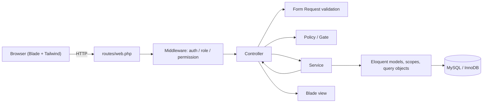
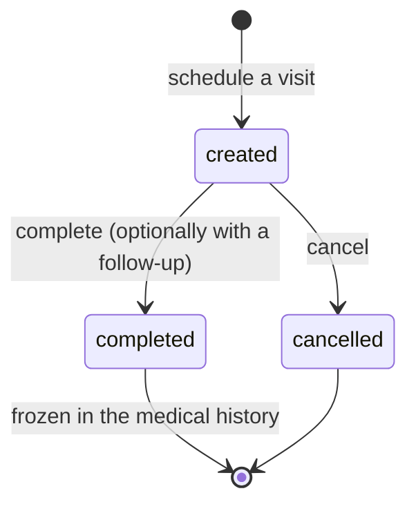
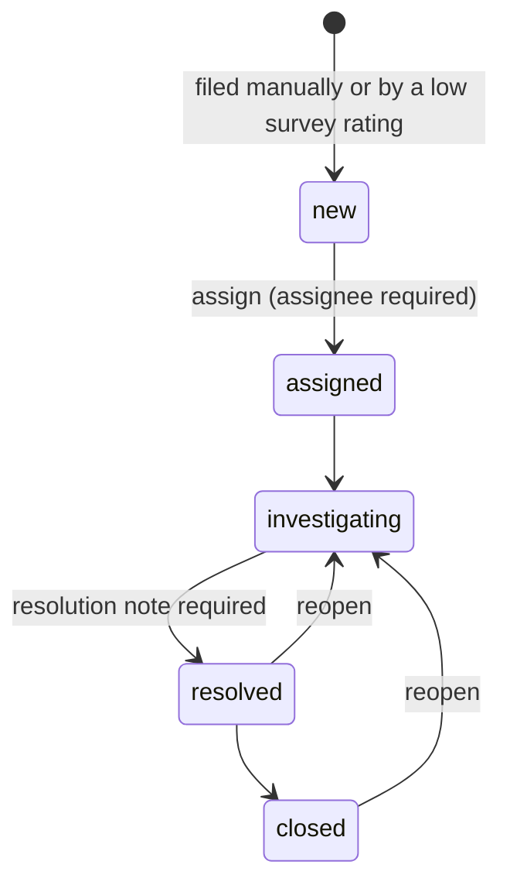
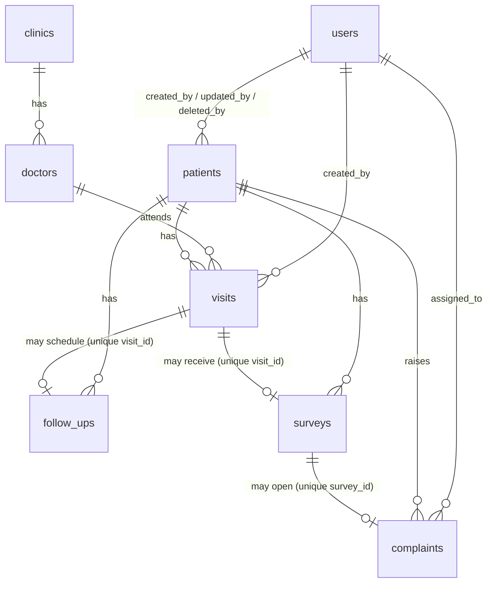

# Clinical Care Center — Medical Audit & Patient CRM

An Arabic-first (RTL) clinic operations CRM built with Laravel. It follows a patient from
registration through visits, follow-ups, satisfaction surveys and complaints, and gives
management a KPI dashboard over the same data.

The system is built for two kinds of staff: **administrators** who run the clinic and
**receptionists** who work with patients all day. There is no patient-facing portal; staff
record what happens at the desk or on the phone.

> **About the name.** The repository is named after the wider product idea: a medical audit
> platform with a patient CRM attached. This application delivers the CRM and clinic
> operations half. The audit/compliance half (audit templates, scoring, corrective actions,
> claims, KPIs) was specified in an early analysis document but is **not** implemented — the
> reconciliation is documented in [Historical analysis](#historical-analysis-documents).

---

## Contents

- [Features](#features)
- [Tech stack](#tech-stack)
- [Architecture](#architecture)
- [Domain workflows](#domain-workflows)
- [Data model](#data-model)
- [Roles and permissions](#roles-and-permissions)
- [Localization](#localization)
- [Getting started](#getting-started)
- [Running the scheduler](#running-the-scheduler)
- [Testing](#testing)
- [Engineering notes](#engineering-notes)
- [Security notes](#security-notes)
- [Historical analysis documents](#historical-analysis-documents)
- [Screenshots](#screenshots)
- [Repository layout](#repository-layout)

---

## Features

| Area | What the application does |
| --- | --- |
| **Authentication** | Session login with username and password, session ID regeneration, logout invalidation, and two rate-limit buckets (5 attempts per username + IP, 20 per IP per minute). Administrators land on the dashboard; receptionists land on clinics. |
| **Patients** | Full record (demographics, blood group, allergies, chronic conditions, emergency contact), auto-generated MRN, unique phone number including archived records, search and status filters, archive/restore instead of hard delete, and per-patient visit history. |
| **Clinics** | Departments with status (active / maintenance / inactive). A clinic cannot be deleted while it still has doctors. |
| **Doctors** | Consultants linked to a clinic, with specialty, contact details, schedule days and status (active / holiday / inactive). A doctor cannot be deleted while visits reference them. |
| **Visits** | Scheduled as `created`, then completed (optionally scheduling the visit's follow-up in the same transaction) or cancelled. Completed visits are frozen: their date, doctor, reason and patient cannot be edited, and they cannot be deleted. Filtering by status, date, doctor, patient and free text. |
| **Follow-ups** | One follow-up per visit. State machine `scheduled → done / missed / cancelled`, `missed → scheduled / cancelled`, `cancelled → scheduled`; `done` is terminal. Completion records the outcome note and completion moment under a row lock. |
| **Surveys** | One satisfaction survey per completed visit, rating 1–5 and an optional comment. A rating below 3 opens a complaint in the same database transaction. Surveys that produced a complaint cannot be deleted. |
| **Complaints** | Filed manually or raised from a low survey rating. Workflow `new → assigned → investigating → resolved → closed`, with assignment, stage advancement, reopen from `resolved`/`closed`, filters and status tiles. Stage-specific input (assignee, resolution note) is validated under the row lock. |
| **Users and roles** | Staff accounts with the Admin and Receptionist roles and 38 permissions. The last administrator can be neither demoted nor deleted, and a user referenced by audit columns cannot be deleted. |
| **Dashboard** (Admin only) | KPI cards and tables for visits, follow-ups, satisfaction, complaints, clinics, doctors and patients, plus the most recent visits. |
| **Localization** | Arabic RTL interface, Arabic validation, authentication, pagination and password-reset messages. |
| **Errors** | Branded 403, 404, 419, 429 and 500 pages. |

### Documented but not implemented

These appear in the historical analyses and are **not** part of the application:

- audit templates, audit sessions, evidence, compliance scoring and corrective actions;
- insurance claims, rejections and rejection reasons;
- facility/department hierarchy (the shipped CRM uses clinics that group doctors);
- an activity log package (state changes are recorded on the records themselves, not in a separate log);
- reports/exports, REST API, notifications (SMS/WhatsApp/email), Docker and CI;
- an English UI translation (the interface ships in Arabic only).

---

## Tech stack

| Layer | Choice | Version |
| --- | --- | --- |
| Language | PHP | `^8.3` required; verified on 8.5.12 |
| Framework | Laravel | 13.34.0 |
| Authorization | spatie/laravel-permission | ^8.3 |
| Database | MySQL / InnoDB (development); SQLite in-memory (tests) | MySQL verified locally; InnoDB `REPEATABLE READ` |
| Views | Blade + hand-built components | — |
| Styling | Tailwind CSS (v4, via the Vite plugin) | 4.3.3 |
| Build | Vite + laravel-vite-plugin | 8.3.2 / ^3.1 |
| Fonts | IBM Plex Sans Arabic + Cairo (Google Fonts) | — |
| Tests | Pest + pest-plugin-laravel | ^5.3 / ^5.0 |
| Code style | Laravel Pint | ^1.27 |
| Dev tooling | Laravel Boost, Telescope, Pail, Tinker | — |

The application is a classic server-rendered Laravel app. There is no JavaScript framework,
no API layer, no queue worker beyond the database queue, and no external service dependency.

---

## Architecture

Requests flow through the following layers; each layer has one job:

```text
routes/web.php (+ the per-module route files)
        │
        ▼
Middleware         auth, role:Admin, spatie permission middleware
        │
        ▼
Form Request       shape and format of the input (app/Http/Requests)
        │
        ▼
Controller         HTTP only: authorize, call a service, pick the view (app/Http/Controllers)
        │
        ▼
Policy / Gate      who may perform the action (app/Policies)
        │
        ▼
Service            business rules, transactions, row locks, workflow state (app/Services)
        │
        ▼
Eloquent model     relationships, casts, scopes, labels (app/Models)
        │
        ▼
MySQL
```



Controllers never contain workflow rules or transactions. Services receive the acting user's
id as an argument instead of reading `Auth` themselves, so the same code can be exercised by a
request, a command or the concurrency harness. Index screens are backed by query objects in
`app/Queries` that centralise filtering and the aggregate tiles.

| Directory | Responsibility |
| --- | --- |
| `app/Http/Controllers` | One controller per module; HTTP concerns only. |
| `app/Http/Requests` | Validation, including conditional rules. |
| `app/Services` | Patient, doctor, clinic, visit, follow-up, survey, complaint, user and dashboard logic. |
| `app/Queries` | Reusable index filters and aggregate queries. |
| `app/Policies` | Permission-based authorization for every domain model. |
| `app/Enums` | Roles, permissions, genders, blood groups. |
| `app/Models` | Relationships, casts, scopes, status labels and transition tables. |
| `app/Console/Commands` | `followups:update-overdue`. |
| `resources/views` | Blade layouts, module screens and reusable components/modals. |

---

## Domain workflows

### Visit lifecycle



A completed visit cannot be edited (date, doctor, reason and patient are frozen; resubmitting
the same date is allowed but does not overwrite the stored time) and cannot be deleted.

### Follow-up transitions

| From | To | Notes |
| --- | --- | --- |
| `scheduled` | `done` | Records the outcome note and `completed_at`. |
| `scheduled` | `missed` | Also set automatically by the scheduled command for overdue rows. |
| `scheduled` | `cancelled` | — |
| `missed` | `scheduled` | Re-scheduling a missed follow-up. |
| `missed` | `cancelled` | — |
| `cancelled` | `scheduled` | — |
| `done` | — | Terminal; later transitions are refused. |

### Complaint workflow



Closing and reopening are administrator permissions. The current assignee can move a
complaint through `assigned → investigating → resolved` without the admin-only
`complaints.advance` permission.

### Survey → complaint

A survey can only be recorded for a completed visit, and only one per visit. When the rating
is below 3, the survey and its complaint are written in one transaction: the complaint is never
missing for a dissatisfied patient, and a failed complaint insert rolls the survey back.

### Overdue follow-ups

`php artisan followups:update-overdue` flips every `scheduled` follow-up whose `due_date` has
passed to `missed`. It is registered in `routes/console.php` to run every minute with
`withoutOverlapping()`, and it can be run by hand.

---

## Data model

Eight domain tables plus the framework tables (sessions, cache, jobs) and the
spatie/laravel-permission tables:



| Table | Notable columns and constraints |
| --- | --- |
| `users` | `username` unique; no email column. Roles come from spatie. |
| `patients` | `mrn` unique, `phone` unique, soft deletes with `deleted_by`, clinical fields, `status`. |
| `clinics` | `status` enum, `created_by` / `updated_by`. |
| `doctors` | `clinic_id` FK, unique `email`, `schedule_days`, `status`. |
| `visits` | `patient_id`, `doctor_id`, `date`, `reason`, `visit_status` (`created` / `completed` / `cancelled`). |
| `follow_ups` | `visit_id` **unique**, `patient_id`, `due_date`, `status`, `reason`, `outcome_note`, `completed_at`. |
| `surveys` | `visit_id` **unique**, `patient_id`, `rating` (1–5), `comment`. |
| `complaints` | `patient_id`, `survey_id` **unique** (nullable), `source`, `status`, `assigned_to`, `resolution_note`, `resolved_at`, `closed_at`. |

Indexes worth knowing: `follow_ups(status, due_date)`, `visits(visit_status, date)`,
`visits(date)`, `complaints(status, created_at)`, `surveys(rating, created_at)`,
`patients(status)`, `patients(deleted_at)`, and the unique keys above.

---

## Roles and permissions

Two roles, 38 permissions (`app/Enums/PermissionEnum.php`), enforced through policies and
route-level middleware:

- **Admin** — every permission, including user management, the dashboard and every workflow
  action.
- **Receptionist** — day-to-day operations: view/create patients, visits, follow-ups, surveys
  and complaints; complete follow-ups and change their status; complete or cancel visits. The
  role cannot manage users, create/update/delete clinics or doctors, delete patients, update or
  delete visits, update or delete follow-ups, update or delete surveys, or update, assign,
  advance, reopen or delete complaints.

Additional integrity rules live in the services rather than in the permission list:

- the last administrator cannot be demoted or deleted (administrator rows are locked and
  counted inside the transaction, so concurrent demotions cannot both pass);
- a user referenced by a `created_by` / `updated_by` / `assigned_to` / `deleted_by` column
  cannot be deleted, which keeps the audit trail and the foreign keys intact;
- clinics with doctors, doctors with visits, completed visits and surveys that produced a
  complaint are refused deletion.

---

## Localization

The interface is Arabic and RTL (`<html lang="ar" dir="rtl">`), with the Arabic translations of
the framework's validation, authentication, pagination and password-reset messages in
`lang/ar/`. The locale comes from `APP_LOCALE` (`ar` in `.env.example`). There is no language
switcher and no English translation of the interface.

Dates and times use the `Africa/Cairo` timezone set in `config/app.php`.

---

## Getting started

### Prerequisites

- PHP 8.3 or newer with the usual Laravel extensions (`pdo`, `mbstring`, `openssl`, `tokenizer`,
  `xml`, `ctype`, `json`, `fileinfo`)
- Composer 2
- Node.js `^20.19` or `>=22.12` (Vite 8 requirement) and npm
- MySQL 8+ for the reference setup (SQLite also works for a quick local look; the concurrency
  harness requires MySQL)

### Installation

```bash
git clone https://github.com/akotb14/medical-audit-patient-crm.git
cd medical-audit-patient-crm
composer install
cp .env.example .env          # PowerShell: Copy-Item .env.example .env
php artisan key:generate
```

Configure `.env` for MySQL:

```dotenv
APP_URL=http://localhost:8000
APP_LOCALE=ar
APP_FALLBACK_LOCALE=ar

DB_CONNECTION=mysql
DB_HOST=127.0.0.1
DB_PORT=3306
DB_DATABASE=patient_crm
DB_USERNAME=your_user
DB_PASSWORD=your_password
```

Then create the database, migrate and (only on a brand-new database) seed:

```bash
php artisan migrate
php artisan db:seed        # demo data; do not run this against a database that already holds data
```

Install the front-end dependencies and build the assets:

```bash
npm install
npm run build
```

Start the application:

```bash
composer run dev     # php artisan serve + queue:listen + vite dev
# or
php artisan serve
```

Open <http://localhost:8000/login>. The root path `/` sends guests to the login screen and
signed-in staff to their landing page, so either URL works.

### Demo data

`php artisan db:seed` runs `DatabaseSeeder`, which creates:

- the roles and permissions, plus one administrator account whose username and password are
  defined in `database/seeders/RolePermissionSeeder.php` — **change them before using the
  application anywhere but a local machine**;
- six receptionist accounts whose usernames are generated by the factory and whose password is
  the factory default in `database/factories/UserFactory.php` — another demo-only value;
- synthetic Arabic sample data: clinics, doctors, patients, visits, follow-ups, surveys and
  complaints.

All sample data is generated (Faker `ar_EG` and hand-written Egyptian sample values). No real
patient or staff data is part of this repository.

### Existing database

If the database already contains data, run only `php artisan migrate`. Do not run `db:seed`,
`migrate:fresh`, `migrate:refresh` or `db:wipe` — those replace or destroy existing records.

### Test environment

The Pest suite is self-contained: `phpunit.xml` points it at an in-memory SQLite database, so
no MySQL server or `.env` database is needed.

---

## Running the scheduler

Overdue follow-ups are updated by a scheduled command. Either run the scheduler in a second
terminal:

```bash
php artisan schedule:work
```

or add the standard cron entry on a server (`* * * * * php /path/to/artisan schedule:run`), or
run the command directly:

```bash
php artisan followups:update-overdue
```

The command is safe to run repeatedly; it only touches `scheduled` rows whose due date has
passed.

---

## Testing

The suite is written with Pest.

```bash
php artisan test --compact              # whole suite
php artisan test --compact --filter=VisitWorkflow
php artisan test --compact tests/Feature/FollowUpWorkflowTest.php
vendor/bin/pest                          # the same suite through the Pest binary
```

| Area | Representative test files |
| --- | --- |
| Authentication and security | `LoginSecurityTest`, `UserSecurityTest` |
| Patients | `PatientCreationTest`, `PatientUpdateTest`, `PatientArchiveTest`, `PatientIndexOrderingTest` |
| Clinics and doctors | `ClinicIndexTest`, `ClinicCreationTest`, `DoctorClinicLinkTest`, `DoctorClinicDeletionTest` |
| Visits | `VisitWorkflowTest`, `VisitDateRulesTest`, `VisitHistoryPaginationTest`, `VisitCountKpiTest` |
| Follow-ups | `FollowUpWorkflowTest` |
| Surveys and complaints | `SurveyWorkflowTest`, `SurveyStatsTest`, `ComplaintWorkflowTest` |
| Users, roles, dropdowns | `UserCrudTest`, `UserIndexTest`, `DropdownOptionsTest` |
| Architecture-level checks | `EagerLoadingTest`, `LocalizationTest` |
| Routing | `HomeRedirectTest`, `ExampleTest` |

**Latest verified run (2026-11-03):** 192 tests, 695 assertions, all passing, on PHP 8.5.12
with an in-memory SQLite database.

### MySQL concurrency harness

Row locking cannot be verified in a single-process SQLite suite, so `tests/Concurrency/` starts
two real PHP processes against MySQL: one holds a row lock inside an open transaction, the other
runs the real controller action against the same row. It covers 12 races: visit edit/delete
against completion or cancellation, follow-up completion and status races, complaint assignment
races, last-administrator deletion/demotion, and MRN collision during patient registration.

```bash
# bash
export CONCURRENCY_DB_DATABASE=patient_crm_verify

# PowerShell
$env:CONCURRENCY_DB_DATABASE = 'patient_crm_verify'

php tests/Concurrency/setup.php     # create the disposable database, migrate, seed roles
php tests/Concurrency/run_all.php   # run every scenario
php tests/Concurrency/cleanup.php   # drop the disposable database
```

The harness refuses to run unless the database name ends in `_verify`, differs from
`DB_DATABASE`, and the live connection is MySQL; anything else aborts with exit code 99 before
a write is made. It is never part of `php artisan test`. See
[`tests/Concurrency/README.md`](tests/Concurrency/README.md) for the checks, exit codes and
known limitations.

**Latest verified run (2026-11-03):** 12 scenarios, 64 checks, 0 failed, ~35 seconds.

---

## Engineering notes

- **Row locks around state changes.** Every workflow transition re-reads and re-checks the row
  under `lockForUpdate()` inside a transaction, so a status validated before the write cannot be
  overwritten by a concurrent completion, cancellation, assignment or reopen.
- **Atomic side effects.** Completing a visit with a follow-up writes both the status change and
  the follow-up in one transaction; a low survey rating writes the survey and the complaint in
  one transaction; a failed insert rolls back both.
- **Frozen medical history.** A visit that reaches a closed status stops accepting edits and
  cannot be deleted. The guard is evaluated after the lock, so a visit closed mid-edit is
  rejected rather than silently overwritten.
- **Last-administrator protection under concurrency.** Administrator rows are locked through a
  join on `model_has_roles` and counted inside the transaction, so two simultaneous demotions
  cannot both see two administrators.
- **MRN collision handling.** Registration retries generation on
  `UniqueConstraintViolationException` (up to five attempts) instead of relying on a
  pre-check alone, which keeps the unique index authoritative.
- **One aggregate query per index.** The tiles above each register are a single aggregate row,
  read from a clone of the listing query with eager loads stripped, so totals describe the whole
  register without issuing discarded relationship queries.

---

## Security notes

Implemented:

- session-based authentication with ID regeneration on login and invalidation on logout;
- per-username+IP and per-IP login throttles;
- a policy check on every model action, plus role middleware on the dashboard;
- CSRF protection on all state-changing forms (Laravel middleware);
- validation in Form Requests and in services for stage-dependent input;
- password hashing with bcrypt (12 rounds by default);
- no credentials committed in `.env` (only `.env.example` placeholders).

Known gaps and deliberate limitations:

- the demo administrator credentials live in `RolePermissionSeeder`, and the seeded receptionists
  share the `UserFactory` default password — these are demo-only values; change them before any
  deployment and never reuse them in production;
- there is no two-factor authentication, email verification, password reset UI or session
  management screen;
- `APP_DEBUG=true` in `.env.example` is a local-development default; production deployments must
  set it to `false`;
- there is no separate audit-log package; changes are attributed through the
  `created_by` / `updated_by` / `deleted_by` columns.

---

## Historical analysis documents

Two analysis documents are kept in the repository as design history. They describe the product
as it was conceived, not necessarily as it was built:

- [`mimi-crm-analysis.md`](mimi-crm-analysis.md) — the original mini-CRM specification
  (patients, visits, follow-ups, surveys, complaints, dashboard). Most of it is implemented; the
  notable differences are that the UI is Blade rather than Filament, there is no activity-log
  package, and the visit workflow, clinics, doctors and MRNs were added beyond the original
  scope.
- [`analysis-and-requirements.md`](analysis-and-requirements.md) — a much wider medical-audit
  platform specification (audit templates, compliance scoring, corrective actions, claims,
  KPIs, exports, API, Docker, CI). **That scope was not built.** It is retained as context for
  the repository name and as a roadmap, not as a description of the current application.

Neither document is a contract for the current behaviour; the tests and the code are.

---

## Screenshots

The screens worth capturing for a portfolio, in order:

| # | Route | Screen | Language |
| --- | --- | --- | --- |
| 1 | `/login` | Arabic RTL sign-in | Arabic |
| 2 | `/dashboard` | Admin KPI dashboard | Arabic |
| 3 | `/patients` | Patient register with MRN and filters | Arabic |
| 4 | `/patients/{id}` | Patient file and visit history | Arabic |
| 5 | `/visits` | Visit register with status tiles | Arabic |
| 6 | `/visits/{id}` | Visit detail with the completion action | Arabic |
| 7 | `/follow_ups` | Follow-up register and overdue tiles | Arabic |
| 8 | `/surveys` | Satisfaction register and rating distribution | Arabic |
| 9 | `/complaints/{id}` | Complaint workflow and stage actions | Arabic |
| 10 | `/clinics` and `/doctors` | Clinic and consultant structure | Arabic |
| 11 | `/users` | Staff and roles (Admin only) | Arabic |

Use the seeded synthetic data only when capturing images — no real patient data.

<!--
Create docs/screenshots/, drop the images there, and uncomment the matching line:


-->

---

## Repository layout

```text
app/
  Console/Commands/     followups:update-overdue
  Enums/                RoleEnum, PermissionEnum, GenderEnum, BloodGroupEnum
  Http/Controllers/     one controller per module
  Http/Requests/        validation per module
  Models/               Patient, Clinic, Doctor, Visit, FollowUp, Survey, Complaint, User
  Policies/             one policy per domain model
  Queries/              index filters and aggregates
  Services/             business rules, transactions, locks
  View/Components/      Blade component classes
database/
  factories/            model factories (synthetic Arabic data)
  migrations/           schema
  seeders/              roles, demo users, sample clinical data
lang/ar/                Arabic framework messages
resources/views/        Blade layouts, screens and components
routes/                 web.php plus one route file per module
tests/
  Feature/              Pest feature tests
  Unit/                 Pest unit tests
  Concurrency/          MySQL row-lock harness (not part of the Pest suite)
```

---

## License

MIT — see the [LICENSE](LICENSE) file for the full text.
